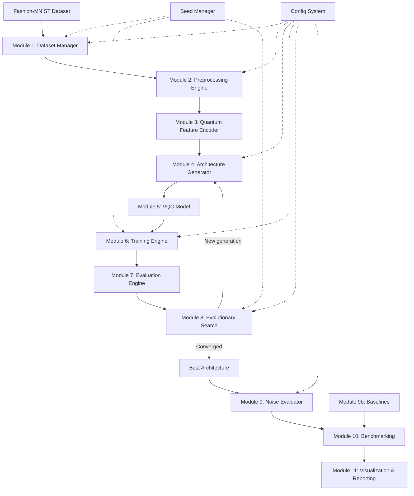
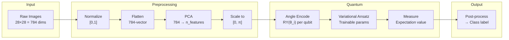
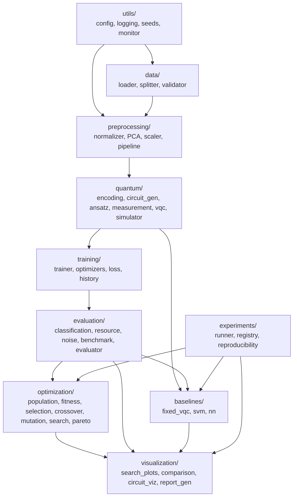

# PHASE 0: Technical Assessment & Implementation Roadmap

## Self-Adaptive Quantum Neural Networks with Resource-Aware Architecture Optimization

---

## 1. Environment Inspection Summary

### 1.1 Hardware Profile

| Resource | Value |
|---|---|
| **OS** | Windows 11 Home (x64) |
| **CPU** | AMD Ryzen 7 7730U — 8 cores / 16 logical threads @ 2.0 GHz base |
| **Total RAM** | ~14 GB |
| **Available RAM** | ~3.3 GB (at inspection time, 76.5% used) |
| **GPU (CUDA)** | ❌ Not available |
| **Disk Free** | ~192 GB |

### 1.2 Key Hardware Implications

> [!WARNING]
> **Memory is the primary constraint.** With only ~14 GB total and ~3 GB available, we must be disciplined about:
> - Limiting quantum simulation to ≤8 qubits (statevector memory scales as $2^n$)
> - Using small evolutionary populations (10–20 candidates)
> - Keeping Fashion-MNIST subsets small (100–500 samples per class for search)
> - Avoiding parallel simulator processes that duplicate memory

- **No GPU acceleration** — quantum simulation on Qiskit Aer (statevector/qasm) runs on CPU. This is acceptable; Qiskit Aer's statevector simulator does not benefit from CUDA anyway in most configurations.
- **16 logical threads** — useful for the classical portions (SVM, NN baselines, data preprocessing) but quantum simulation iterations will be sequential.

### 1.3 Software Environment

| Component | Version | Status |
|---|---|---|
| Python | 3.11.9 | ✅ Compatible with Qiskit 1.4.x |
| numpy | 2.4.6 | ⚠️ Will need isolated venv (see below) |
| scipy | 1.17.1 | ⚠️ Qiskit pins older scipy |
| scikit-learn | 1.9.1 | ✅ |
| pandas | 3.0.3 | ✅ |
| matplotlib | 3.11.2 | ✅ |
| PyTorch | 2.14.0 | ✅ (for NN baseline) |
| torchvision | 0.29.1 | ✅ (can load Fashion-MNIST) |
| PyYAML | 6.0.3 | ✅ |
| pytest | 9.1.1 | ✅ |
| psutil | 7.2.2 | ✅ (system monitoring) |
| Qiskit | ❌ **Not installed** | Must install |
| Qiskit Aer | ❌ **Not installed** | Must install |
| Qiskit ML | ❌ **Not installed** | Must install |
| Qiskit Algorithms | ❌ **Not installed** | Must install |

### 1.4 Existing Workspace

The scratch directory at `C:\Users\ud127\.gemini\antigravity\scratch` contains unrelated projects. **No existing quantum project found.** We will create a fresh project directory.

---

## 2. Dependency Compatibility Analysis

> [!IMPORTANT]
> **This is the most critical finding of Phase 0.** The Qiskit ecosystem has undergone a major breaking migration (v1.x → v2.x). Choosing the wrong version combination will cause cascading API failures.

### 2.1 Version Compatibility Matrix (Investigated)

| Stack Combination | Compatible? | Notes |
|---|---|---|
| Qiskit 2.6.1 + Aer 0.18.2 + QML 0.9.1 | ✅ Mutually compatible | V2 primitives only; latest |
| Qiskit 1.4.2 + Aer 0.17.2 + QML 0.9.1 | ❌ **CONFLICT** | QML 0.9.1 requires `qiskit>=2.0` |
| Qiskit 1.4.2 + Aer 0.16.4 + QML 0.8.4 + Algorithms 0.4.0 | ✅ Resolves cleanly | Mature, well-documented APIs |

### 2.2 Recommended Dependency Decision

**Primary recommendation: Qiskit 1.4.2 stack in an isolated virtual environment.**

Rationale:
1. **Qiskit 1.4.2 + QML 0.8.4** has the most mature VQC API with extensive documentation and examples.
2. `qiskit-machine-learning 0.8.x` provides a high-level `VQC` class with `fit()`/`predict()`/`score()` scikit-learn-style interface.
3. `qiskit-algorithms 0.4.0` provides classical optimizers (COBYLA, SPSA, L-BFGS-B) via a clean API.
4. The V2 `StatevectorEstimator` primitive from `qiskit.primitives` works natively — no IBM Runtime dependency needed.
5. `qiskit-aer 0.16.4` provides the `AerSimulator` with noise model support.

**Alternative considered: Qiskit 2.6.1 + QML 0.9.1.** This is the cutting-edge stack, but QML 0.9.1 has newer deprecation patterns, less community example coverage, and risks hitting undocumented edge cases. For a research project that prioritizes stability and reproducibility, the 1.4.x line is the safer engineering choice.

> [!NOTE]
> **Decision recorded:** We will use the Qiskit 1.4.2 ecosystem. If a compelling reason arises during implementation to migrate to 2.x, I will flag it and request approval.

### 2.3 Virtual Environment Strategy

**Mandatory: Create a dedicated virtual environment.** The system Python has numpy 2.4.6 and scipy 1.17.1. The Qiskit stack will install scipy 1.15.3 and its own pinned dependencies. Installing into the system Python would break existing packages.

```
Project venv at: quantum-architecture-optimizer/.venv/
```

### 2.4 Pinned Dependency List

```text
# Core quantum stack
qiskit==1.4.2
qiskit-aer==0.16.4
qiskit-machine-learning==0.8.4
qiskit-algorithms==0.4.0

# Scientific computing (versions resolved by pip with qiskit)
numpy>=1.23,<2.0        # Qiskit 1.4.x compatible range
scipy>=1.10,<1.16       # Pinned by qiskit-aer
scikit-learn>=1.2

# Data & visualization
pandas>=2.0
matplotlib>=3.7
pillow>=10.0

# Configuration & utilities
pyyaml>=6.0
python-dotenv>=1.0
psutil>=5.9
tabulate>=0.9

# ML baselines
torch>=2.0
torchvision>=0.15

# Testing & quality
pytest>=8.0
ruff>=0.4

# CLI
typer>=0.12
```

> [!WARNING]
> numpy may be downgraded to 1.x inside the venv. This is expected and acceptable — the venv is isolated.

---

## 3. System Architecture Design

### 3.1 High-Level Architecture Diagram



### 3.2 Data Flow Specification



### 3.3 Architecture Schema (Candidate Representation)

Each VQC candidate architecture will be represented as a structured configuration:

```python
@dataclass
class ArchitectureConfig:
    arch_id: str              # Unique identifier (hash-based)
    n_qubits: int             # 4, 6, or 8
    n_layers: int             # 1–6 ansatz repetitions
    rotation_gates: list[str] # Subset of ["rx", "ry", "rz"]
    entanglement_type: str    # "linear", "circular", "pairwise"
    entanglement_freq: int    # Apply entanglement every N layers
    feature_map_type: str     # "angle" (initially)
    measurement_type: str     # "parity" or "single_qubit"
```

### 3.4 Module Dependency Graph



---

## 4. Computational Budget Assessment

### 4.1 Single VQC Training Cost Estimate

| Parameter | Value | Notes |
|---|---|---|
| Qubits | 4 | Statevector size: 16 complex floats |
| Ansatz layers | 2 | ~16 trainable parameters |
| Training samples | 200 | 100 per class |
| Optimizer iterations | 50–100 | COBYLA or SPSA |
| Estimated time per model | 30–120 seconds | Statevector simulator on CPU |

### 4.2 Architecture Search Budget

| Parameter | Conservative | Moderate |
|---|---|---|
| Population size | 10 | 20 |
| Generations | 5 | 10 |
| Total evaluations | ~50 | ~200 |
| Estimated wall time | ~1.5 hours | ~6 hours |

> [!TIP]
> **Strategy:** Start with the conservative budget for correctness validation, then scale up if time permits. The framework must support configurable budgets.

### 4.3 Memory Estimates

| Qubits | Statevector Size | Memory (complex128) |
|---|---|---|
| 4 | 16 | ~256 bytes |
| 6 | 64 | ~1 KB |
| 8 | 256 | ~4 KB |
| 10 | 1024 | ~16 KB |
| 12 | 4096 | ~64 KB |

Statevector simulation memory is negligible up to 8 qubits. The real memory pressure comes from holding training data, model histories, and search records simultaneously. With ~3 GB available RAM, this is manageable if we avoid redundant copies.

---

## 5. Risk Assessment

### 5.1 Technical Risks

| # | Risk | Severity | Mitigation |
|---|---|---|---|
| R1 | Qiskit API deprecation / breaking changes | **High** | Pin exact versions; use venv; test imports immediately |
| R2 | VQC training doesn't converge on Fashion-MNIST | **Medium** | Start with easily separable classes (e.g., T-shirt vs Ankle boot); validate with synthetic data first |
| R3 | Evolutionary search too slow for meaningful exploration | **Medium** | Small population, few generations; caching; configurable budgets |
| R4 | Memory exhaustion during search | **Medium** | Stream results to disk; limit concurrent evaluations; monitor with psutil |
| R5 | scipy downgrade breaks other system packages | **Low** | Isolated venv eliminates this |
| R6 | Noise model makes all circuits equally bad | **Low** | Use realistic but moderate noise parameters; test multiple noise levels |
| R7 | Crossover produces invalid circuits | **Medium** | Structural validation after every genetic operation; repair or reject |
| R8 | No meaningful difference found between architectures | **Low** | This is a valid negative result; the framework reports what it measures |

### 5.2 Scientific Risks

| # | Risk | Mitigation |
|---|---|---|
| S1 | Data leakage inflating results | PCA fit on train only; strict split discipline; automated checks |
| S2 | Overfitting to validation during search | Use separate validation and test sets; final eval on held-out test only |
| S3 | Non-reproducible results | Seed management for all random operations; save all configs |
| S4 | Unfair classical vs quantum comparison | Same data splits, same PCA features, same metrics |

---

## 6. Implementation Roadmap

### Phase-by-Phase Plan


### Detailed Phase Plan

| Phase | Objective | Key Deliverables | Est. Effort | Dependencies |
|---|---|---|---|---|
| **1** | Project scaffolding | Directory structure, venv, config system, logging, seed manager, test framework | Foundation | Phase 0 approval |
| **2** | Dataset & preprocessing | Fashion-MNIST loader, PCA pipeline, data splits, leakage prevention, exploratory plots | Data pipeline | Phase 1 |
| **3** | Quantum encoding & circuits | Angle encoding module, ansatz builder, measurement logic, circuit metadata, circuit visualizations | Quantum foundation | Phase 2 |
| **4** | Baseline VQC | Working VQC training loop, loss tracking, prediction, evaluation metrics | **Critical milestone** | Phase 3 |
| **5** | Architecture generator | Architecture schema, random generation, validation, metadata extraction | Search foundation | Phase 4 |
| **6** | Evaluation engine | Unified evaluation protocol, classification + resource + noise metrics | Evaluation | Phase 5 |
| **7** | Evolutionary search | Population, fitness, selection, crossover, mutation, search loop, history logging | **Core contribution** | Phase 6 |
| **8** | Noise evaluation | Qiskit Aer noise models, ideal vs noisy comparison | Noise analysis | Phase 7 |
| **9** | Classical & fixed baselines | SVM, MLP, fixed VQCs, fair comparison protocol | Benchmarking | Phase 4, Phase 8 |
| **10** | Full experiments | Experiments A–F, ablation studies, repeated seeds | Research results | Phase 9 |
| **11** | Visualization & reporting | All required plots, tables, summary reports | Research outputs | Phase 10 |
| **12** | Documentation & audit | README, methodology, architecture docs, limitations, final report | Deliverables | Phase 11 |

### Critical Path

```
Phase 2 (Data) → Phase 3 (Encoding) → Phase 4 (VQC) → Phase 7 (Search) → Phase 10 (Experiments)
```

Phase 4 is the first major **go/no-go gate**: if we cannot train a VQC on Fashion-MNIST features, the architecture search has nothing to optimize.

---

## 7. Project Directory Structure

```text
C:\Users\ud127\.gemini\antigravity\scratch\quantum-architecture-optimizer\
│
├── README.md
├── requirements.txt
├── pyproject.toml
├── .gitignore
├── .env.example
│
├── configs/
│   ├── dataset.yaml
│   ├── preprocessing.yaml
│   ├── quantum.yaml
│   ├── training.yaml
│   ├── evolutionary_search.yaml
│   ├── noise.yaml
│   └── experiments.yaml
│
├── data/
│   ├── raw/
│   ├── processed/
│   └── metadata/
│
├── src/
│   ├── __init__.py
│   │
│   ├── data/
│   │   ├── __init__.py
│   │   ├── dataset_loader.py
│   │   ├── dataset_splitter.py
│   │   └── data_validator.py
│   │
│   ├── preprocessing/
│   │   ├── __init__.py
│   │   ├── image_processor.py
│   │   ├── pca_reducer.py
│   │   ├── feature_scaler.py
│   │   └── preprocessing_pipeline.py
│   │
│   ├── quantum/
│   │   ├── __init__.py
│   │   ├── feature_encoding.py
│   │   ├── circuit_generator.py
│   │   ├── architecture_schema.py
│   │   ├── ansatz_builder.py
│   │   ├── measurement.py
│   │   ├── vqc_model.py
│   │   └── simulator.py
│   │
│   ├── training/
│   │   ├── __init__.py
│   │   ├── trainer.py
│   │   ├── optimizers.py
│   │   ├── loss_functions.py
│   │   └── training_history.py
│   │
│   ├── optimization/
│   │   ├── __init__.py
│   │   ├── population.py
│   │   ├── fitness.py
│   │   ├── selection.py
│   │   ├── crossover.py
│   │   ├── mutation.py
│   │   ├── evolutionary_search.py
│   │   └── pareto.py
│   │
│   ├── evaluation/
│   │   ├── __init__.py
│   │   ├── classification_metrics.py
│   │   ├── resource_metrics.py
│   │   ├── noise_evaluator.py
│   │   ├── benchmark.py
│   │   └── evaluator.py
│   │
│   ├── baselines/
│   │   ├── __init__.py
│   │   ├── fixed_vqc.py
│   │   ├── classical_svm.py
│   │   └── classical_nn.py
│   │
│   ├── visualization/
│   │   ├── __init__.py
│   │   ├── search_plots.py
│   │   ├── comparison_plots.py
│   │   ├── circuit_visualizer.py
│   │   └── report_generator.py
│   │
│   ├── experiments/
│   │   ├── __init__.py
│   │   ├── experiment_runner.py
│   │   ├── experiment_registry.py
│   │   └── reproducibility.py
│   │
│   └── utils/
│       ├── __init__.py
│       ├── config_loader.py
│       ├── logging_config.py
│       ├── seed_manager.py
│       └── system_monitor.py
│
├── scripts/
│   ├── download_dataset.py
│   ├── run_preprocessing.py
│   ├── run_baseline.py
│   ├── run_architecture_search.py
│   ├── run_noise_experiments.py
│   ├── run_benchmarks.py
│   └── generate_report.py
│
├── tests/
│   ├── __init__.py
│   ├── conftest.py
│   ├── test_dataset.py
│   ├── test_preprocessing.py
│   ├── test_encoding.py
│   ├── test_circuit_generator.py
│   ├── test_vqc.py
│   ├── test_evolutionary_search.py
│   ├── test_noise.py
│   └── test_evaluation.py
│
├── experiments/
│   ├── configs/
│   ├── logs/
│   ├── results/
│   ├── checkpoints/
│   └── figures/
│
└── docs/
    ├── architecture.md
    ├── methodology.md
    ├── experiment_protocol.md
    ├── installation.md
    ├── user_guide.md
    └── limitations.md
```

---

## 8. Key Architectural Decisions

| # | Decision | Rationale |
|---|---|---|
| AD-1 | **Qiskit 1.4.2** over 2.6.1 | Better documented QML API; avoids bleeding-edge deprecation risks; pip resolution confirmed clean |
| AD-2 | **Isolated virtual environment** | System Python has incompatible numpy/scipy; prevents cross-project contamination |
| AD-3 | **StatevectorEstimator** as default primitive | Deterministic, fast for ≤8 qubits, no shot noise, ideal for architecture comparison |
| AD-4 | **AerSimulator** for noisy evaluation | Only when explicitly running noise experiments; separate from ideal evaluation |
| AD-5 | **Angle encoding (RY)** as initial feature map | Simple, well-understood, one qubit per feature; extensible later |
| AD-6 | **Binary classification first** | Reduces VQC output mapping complexity; multiclass as optional extension |
| AD-7 | **COBYLA optimizer** as default | Gradient-free, well-suited for noisy quantum landscapes; SPSA as alternative |
| AD-8 | **Scalar weighted fitness** with optional Pareto | Start with weighted sum (simpler, debuggable); add NSGA-II if time permits |
| AD-9 | **torchvision for dataset loading** | Already installed; reliable Fashion-MNIST loader; avoids manual download |
| AD-10 | **Typer for CLI** | Already installed; modern, type-hint-based CLI framework |

---

## 9. Testing Strategy

| Level | Scope | When |
|---|---|---|
| **Unit** | Individual functions: PCA, encoding, gate construction, fitness calculation, selection, mutation | After each module |
| **Integration** | Pipeline segments: data→preprocessing→encoding; encoding→circuit→training | After connecting modules |
| **End-to-end** | Mini experiment: 20 samples, 4 qubits, 1 layer, pop=3, gen=2 | After Phase 7 |
| **Regression** | Reproducibility: same seed → same results; circuit validity invariants | Continuous |

All tests will use `pytest` with fixtures defined in `conftest.py`.

---

## 10. Acceptance Criteria Traceability

| Acceptance ID | Phase | Verification Method |
|---|---|---|
| A01 – Dataset loads | Phase 2 | Unit test: assert shape == (N, 28, 28) |
| A02 – Binary class selection | Phase 2 | Unit test: assert unique labels == {selected} |
| A03 – No data leakage | Phase 2 | Integration test: PCA fit on train only |
| A04 – Feature encoding | Phase 3 | Unit test: encoded circuit executes |
| A05 – Circuit generation | Phase 3 | Unit test: valid QuantumCircuit returned |
| A06 – Baseline VQC trains | Phase 4 | Integration test: loss decreases, accuracy > random |
| A07 – Multiple architectures | Phase 5 | Unit test: N distinct configs generated |
| A08 – Metadata extraction | Phase 5 | Unit test: depth, gates match circuit |
| A09 – Evolutionary search runs | Phase 7 | E2E test: search completes, history saved |
| A10 – Fitness/resource metrics | Phase 7 | Integration test: structured results returned |
| A11 – Noise experiments | Phase 8 | Test: ideal and noisy metrics differ |
| A12 – Fixed VQC baselines | Phase 9 | Test: 4+ fixed configs evaluated |
| A13 – Classical baselines | Phase 9 | Test: SVM and NN produce predictions |
| A14 – Validation-based selection | Phase 7 | Audit: test data not used during search |
| A15 – Final test evaluation | Phase 10 | Audit: single test evaluation after search |
| A16 – Search history saved | Phase 7 | Test: JSON/CSV files exist and parse |
| A17 – Visualizations generated | Phase 11 | Test: PNG files generated |
| A18 – Tests pass | Continuous | pytest exit code 0 |
| A19 – Documentation complete | Phase 12 | File existence check |
| A20 – Reproducibility | Phase 10 | Re-run with same seed → same metrics |

---

## 11. Recommended Next Step

**Upon approval, proceed to Phase 1: Project Scaffolding.**

Phase 1 will:
1. Create the project directory at `C:\Users\ud127\.gemini\antigravity\scratch\quantum-architecture-optimizer\`
2. Initialize the virtual environment and install the pinned Qiskit stack
3. Verify all imports succeed
4. Set up the configuration system, logging, and seed management
5. Create the test framework with `conftest.py`
6. Run initial smoke tests

**Estimated Phase 1 duration:** Single session.

---

*Document generated: 2026-10-31 | Phase 0 — Repository Inspection and Technical Planning*
