# Phase 13 UI Architecture Specification

**Project:** Self-Adaptive Quantum Neural Networks with Resource-Aware Architecture Optimization  
**Module:** Interactive Research Dashboard (Phase 13)  
**Frameworks:** Streamlit 1.47+, Plotly 6.8+, Qiskit 1.4.2, Qiskit Aer 0.16.4, Qiskit Machine Learning 0.8.4  
**Date:** November 2026  

---

## 1. Architectural Overview & System Decomposition

The Phase 13 Research Dashboard is built as an interactive scientific computing application adhering to strict separation of concerns, zero-leakage data protocols, and asynchronous execution safety.

```mermaid
graph TD
    subgraph UI_Presentation_Layer ["UI Presentation Layer (Streamlit & Plotly)"]
        APP["app.py (Portal Entrypoint)"]
        P1["1_Overview.py"]
        P2["2_Dataset_Explorer.py"]
        P3["3_Quantum_Circuit_Lab.py"]
        P4["4_Architecture_Search.py"]
        P5["5_Noise_Analysis.py"]
        P6["6_Model_Benchmarking.py"]
        P7["7_Experiment_History.py"]
        P8["8_Documentation.py"]
        COMP["UI Components (Sidebar, MetricCards, Charts, CircuitViewer)"]
    end

    subgraph Service_Adapter_Layer ["Service Adapter Layer (ui/services)"]
        DS_SVC["DatasetService"]
        CIRC_SVC["CircuitService"]
        SRCH_SVC["SearchService (Threaded)"]
        NOISE_SVC["NoiseService"]
        BENCH_SVC["BenchmarkService"]
        EXP_SVC["ExperimentService"]
    end

    subgraph Core_Backend ["Quantum Machine Learning Core (src/)"]
        SRC_DATA["src.data (Preprocessing, PCA, Zero-Leakage Split)"]
        SRC_CIRC["src.circuits (CircuitGenerator, ArchitectureConfig)"]
        SRC_MODELS["src.models (VQC, COBYLA Training)"]
        SRC_SRCH["src.search (EvolutionarySearchEngine, Evaluator)"]
        SRC_NOISE["src.noise (NoiseModels, Fidelity Evaluator)"]
        SRC_BENCH["src.evaluation (BenchmarkSuite, Metrics)"]
    end

    subgraph Storage_Artifacts ["Persistent Artifacts (data/ & experiments/)"]
        PKL["data/metadata/preprocessing_pipeline.pkl"]
        NPZ["data/processed/fashion_mnist_binary_*.npz"]
        JSON_EXP["experiments/results/*.json"]
        DOCS["docs/*.md"]
    end

    APP --> P1 & P2 & P3 & P4 & P5 & P6 & P7 & P8
    P1 & P2 & P3 & P4 & P5 & P6 & P7 & P8 --> COMP
    COMP --> Service_Adapter_Layer
    P1 & P2 & P3 & P4 & P5 & P6 & P7 & P8 --> Service_Adapter_Layer

    DS_SVC --> SRC_DATA & PKL & NPZ
    CIRC_SVC --> SRC_CIRC
    SRCH_SVC --> SRC_SRCH & JSON_EXP
    NOISE_SVC --> SRC_NOISE & JSON_EXP
    BENCH_SVC --> SRC_BENCH & JSON_EXP
    EXP_SVC --> JSON_EXP
    P8 --> DOCS
```



---

## 2. Component Hierarchy & Responsibilities

### 2.1 Entrypoint & Global State
- **`ui/app.py`**: Configures global Streamlit layout, registers browser window parameters, applies the dark theme CSS (`ui/styles/theme.css`), initializes session state caches via `ui/utils/state.py`, and renders the interactive executive portal.
- **`ui/utils/state.py`**: Ensures thread-safe, centralized initialization of Streamlit `st.session_state` variables:
  - `theme`: Consistent research dark color palette.
  - `active_preset`: Current selected quantum circuit preset ("Optimized VQC", "Baseline VQC", etc.).
  - `search_job`: Reference to asynchronous `SearchJobState` background thread.
  - `custom_circuit_config`: Real-time mutable `ArchitectureConfig`.

### 2.2 Reusable UI Components (`ui/components/`)
1. **`sidebar.py`**:
   - Renders system navigation branding.
   - Monitors live backend health (verifies Qiskit 1.4.2 runtime, Aer simulator status, processed dataset availability, and saved experiment payloads).
   - Displays host hardware runtime telemetry (CPU cores, memory, OS platform).
2. **`metric_cards.py`**:
   - Formats technical KPIs into card containers (`render_metric_card`).
   - Renders multi-column responsive grid rows (`render_kpi_grid_row`).
3. **`charts.py`**:
   - Generates responsive Plotly charts adhering to the custom dark theme (`#0a0f1d` background, `#131c31` card fill, `#06b6d4` cyan, `#8b5cf6` violet accents):
     - `create_fitness_convergence_plot`: Evolution of Best vs. Average fitness over generations.
     - `create_pareto_scatter`: Multi-objective Pareto frontier plotting accuracy against circuit depth, highlighting non-dominated architectures.
     - `create_model_comparison_bar`: Classical vs. Quantum model benchmark metrics.
     - `create_noise_degradation_plot`: Line chart tracking classification accuracy decay across NISQ noise tiers (Low, Medium, High).
     - `create_pca_variance_plot`: Scree and cumulative explained variance curves.
     - `create_class_distribution_bar`: Class balance verification.
4. **`circuit_viewer.py`**:
   - Compiles and visualizes quantum circuits dynamically using Qiskit's visualization engine.
   - Supports Matplotlib graphic rendering with downloadable high-res PNG (200 DPI).
   - Provides an ASCII / Unicode text fallback for terminal and low-bandwidth exploration.

---

## 3. Service Layer Architecture (`ui/services/`)

The service layer acts as a decoupled adapter between Streamlit UI views and the scientific computation core (`src/`):

| Service | Target Backend Module | Key Operations |
|---|---|---|
| **`DatasetService`** | `src.data.dataset`, `src.data.preprocessing` | Loads preprocessed NPZ arrays, inspects pipeline stages (Raw $\to$ Norm $\to$ PCA $\to$ Angle), prevents data leakage by loading pre-fitted transforms. |
| **`CircuitService`** | `src.circuits.circuit_generator` | Compiles arbitrary `ArchitectureConfig` objects into Qiskit `QuantumCircuit`, extracts gate distributions, circuit depth, parameter counts, and exports figures. |
| **`SearchService`** | `src.search.evolutionary` | Launches background worker threads (`threading.Thread`) for evolutionary architecture optimization, safely polling generation progress and best fitness telemetry. |
| **`NoiseService`** | `src.noise.noise_models`, `qiskit_aer` | Evaluates circuit noise resilience under thermal relaxation, depolarizing, and readout errors; exposes saved noise benchmarks. |
| **`BenchmarkService`** | `src.evaluation.benchmark` | Integrates benchmark results across 7 models (Linear SVM, RBF SVM, MLP, Shallow VQC, Standard VQC, Deep VQC, Optimized VQC). Computes Pareto dominance. |
| **`ExperimentService`** | File system (`experiments/results/*.json`) | Automatically inventories experiment runs, parses JSON artifacts, renders raw payloads, and exports CSV summaries. |

---

## 4. Multi-Page Structure & Flow

```
ui/
├── app.py                      # Main Landing & Executive Portal
├── styles/
│   └── theme.css               # Research Dark Theme CSS
├── utils/
│   ├── formatting.py           # Numbers, percentages, runtime formatters
│   ├── validation.py           # Hyperparameter & constraint validators
│   └── state.py                # Session state initialization & keys
├── components/
│   ├── sidebar.py              # Navigation header, backend health, hardware specs
│   ├── metric_cards.py         # Technical KPI cards & responsive grid rows
│   ├── charts.py               # Plotly dark-themed interactive visualizations
│   └── circuit_viewer.py       # Qiskit circuit drawer with Matplotlib & PNG export
├── services/
│   ├── dataset_service.py      # Fashion-MNIST & PCA feature pipeline
│   ├── circuit_service.py      # Quantum circuit compiler & gate analysis
│   ├── search_service.py       # Asynchronous evolutionary search runner
│   ├── noise_service.py        # NISQ noise simulation & fidelity analysis
│   ├── benchmark_service.py    # 7-model benchmark comparison & Pareto front
│   └── experiment_service.py   # Run inventory, JSON viewer & CSV exporter
└── pages/
    ├── 1_Overview.py           # Executive dashboard & research summary
    ├── 2_Dataset_Explorer.py   # Fashion-MNIST pipeline & PCA analysis
    ├── 3_Quantum_Circuit_Lab.py # Real-time interactive circuit designer
    ├── 4_Architecture_Search.py# Live evolutionary search & telemetry
    ├── 5_Noise_Analysis.py     # Aer noise simulation & degradation tables
    ├── 6_Model_Benchmarking.py # Classical vs. Quantum comparative analysis
    ├── 7_Experiment_History.py # Historical runs, JSON viewer & CSV export
    └── 8_Documentation.py      # Research specifications & knowledge base
```

---

## 5. Asynchronous Search Execution Design

Evolutionary architecture search is computationally intensive due to repeated VQC parameter optimizations (COBYLA) across population candidates. To prevent Streamlit UI freezes:

1. **Thread-Safe State Machine (`SearchJobState`)**:
   - Manages state flags (`is_running`, `completed`, `cancelled`).
   - Uses `threading.Lock` to synchronize telemetry updates (generation, best fitness, average fitness, generation logs).
2. **Background Daemon Worker (`threading.Thread`)**:
   - The evolutionary loop runs inside a detached daemon thread.
   - On each generation completion, callback functions update `SearchJobState`.
3. **UI Polling & Auto-Refresh**:
   - Streamlit UI checks `SearchJobState` status.
   - Uses `st.rerun()` with periodic intervals or user-driven refresh to update telemetry cards, generation progress bars, and convergence plots.
4. **Cooperative Cancellation**:
   - Setting `cancel_requested = True` terminates candidate evaluation gracefully at the next generation boundary.

---

## 6. Zero-Data-Leakage Enforcement in UI

- All exploratory visualizations (e.g. PCA scree plots, 2D component projections, angle distributions) strictly use the pre-fitted PCA pipeline stored in `data/metadata/preprocessing_pipeline.pkl`.
- Test set samples are evaluated purely through inference without recomputing PCA projection vectors or normalization scalers.
- Any custom circuit evaluation performed within the UI explicitly executes against validation subsets or designated test samples without updating model parameters on test data.
